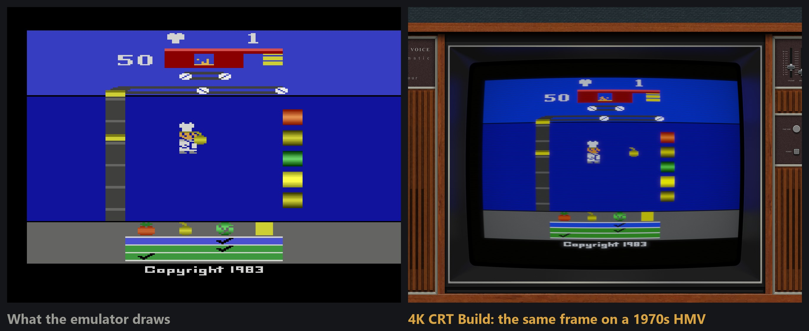

# Shu's LaunchBox 4K CRT Build

Turn your own game collection into a finished LaunchBox library for a big 4K TV: every system in its own era TV or monitor, real arcade cabinets around MAME games, a CRT look tuned per machine, and covers, screenshots and manuals filled in from free, open sources.

**No games, BIOS or firmware are included, downloaded or linked. You bring your own.** See [DISCLAIMER.md](DISCLAIMER.md).

## Quick start

1. Download this repo (green Code button, Download ZIP) and unzip it anywhere.
2. Double-click **`setup.bat`**. If Python isn't on your PC it offers to install Python 3.12 for you (official package, through Windows' own winget); say Y. Without winget it opens the [Python download page](https://www.python.org/downloads/) instead: tick "Add python.exe to PATH", install, then run `setup.bat` again.

The wizard walks you through it:

| Step | What happens |
|---|---|
| Welcome | What this is, and a tick to confirm you'll use your own games and BIOS |
| Your folders | Point it at your emulation folder, LaunchBox, RetroArch and MAME (or press Auto-find) |
| What you need | Every emulator, shader and bezel pack, with a button to its official download page and a tick when it's installed |
| Systems, folders and detail | Tick the systems you want, press Change if a system's games are in another folder, then pick Lite, Standard or Ultimate |
| Pick your looks | Renders one of your own games per system in every TV, monitor and handheld. Press Choose and click the look you want; anything you leave gets Anima's pick |
| Build | Runs only your ticked systems with a live log. Cancel stops it; running it again is safe |
| Finished | Open LaunchBox |

**Got a Steam Deck?** [Shu's Steam Deck CRT Build](https://github.com/shu2600/steam-deck-crt-build) sends this library to EmuDeck with the light version of every look.

Prefer the command line? [docs/GUIDE.md](docs/GUIDE.md) has every step.

## What it does

**Builds the library** (`lb_build.py`)
- Reads your ROM folders and writes LaunchBox's own data: platforms, emulators, games, with titles, years, developers, genres and descriptions from LaunchBox's metadata database.
- Picks the cleanest copy of each game: verified dumps first; betas, bad dumps, hacks and trainers last; English releases before others. Demos, test carts and BIOS files are left out.
- Matches names that differ only in style (`Gauntlet 4` / `Gauntlet IV`, `Auto Duel` / `Autoduel`).
- Arcade: parent sets only. Splits 32X out of Mega Drive sets, adds Game & Watch and laserdisc games.
- Safe to re-run: favourites, play history, ratings and manual links carry over.

**Fills the artwork** (only where something is missing; never overwrites yours)

| Tool | Source | Fills |
|---|---|---|
| `lb_art.py` | LaunchBox's image server | covers, 3D boxes, logos, screenshots, fanart |
| `crc_thumbs.py` | libretro-database + libretro-thumbnails | covers and screenshots matched by ROM checksum |
| `libretro_thumbs.py` | libretro-thumbnails | covers by name |
| `arcadedb_art.py` | ArcadeDB | arcade flyers, screenshots, marquees |
| `zxdb_inlays.py` | ZXDB / Spectrum Computing | Spectrum inlays, loading screens, in-game screens |
| `make_3dbox.py` | your covers | 3D boxes |
| `lb_playlists.py`, `menu_icons.py`, `fav_mark.py` | your library | best-of and themed playlists, menu icons, favourites |

**Sets the look**
- Per-emulator presets for the RetroArch Mega Bezel shader (in `configs/retroarch`): 80s systems in a period TV with super-xBR + Guest CRT, 90s consoles in a Samsung-style TV on a wallpapered wall, Amiga on a 1084S, ST and Dreamcast on their monitors, handhelds on their own shells.
- `bezel_review.py` renders the previews; `apply_pick.py` switches a system to the look you choose.
- Arcade cabinets via MAME artwork (Lights Out, realistic cabinets, The Bezel Project).

**60 fps and widescreen** (in `configs/emulators`)
- Per-game settings that switch on the emulators' own community patches: PS2 (PCSX2), PS3 (RPCS3), Xbox 360 (Xenia Canary), GameCube (Dolphin). See the readme in that folder.

## Legal

- Your games and BIOS are yours to supply. Nothing here helps you obtain them.
- Third-party bezels, shaders and artwork are downloaded by you from their creators. Small variations a look needs are made on your own PC from your own copy, never shipped here.
- Art and metadata come only from public services built for it, for games already in your library.
- Trademarks belong to their owners; this project isn't affiliated with any of them.

Full text: [DISCLAIMER.md](DISCLAIMER.md). Credits: [CREDITS.md](CREDITS.md). Code licence: [LICENSE](LICENSE).

---

Built by Shu and Anima. Everything for a Reason.
